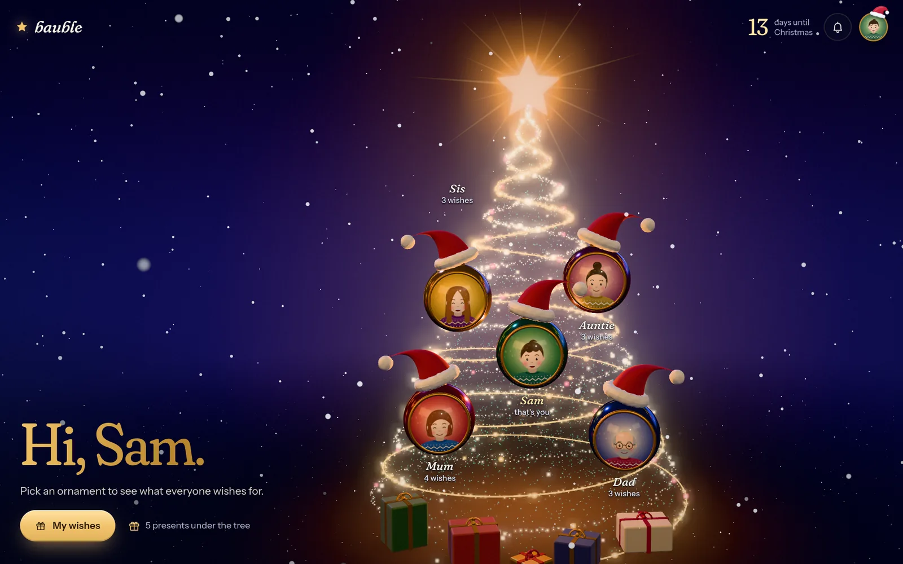
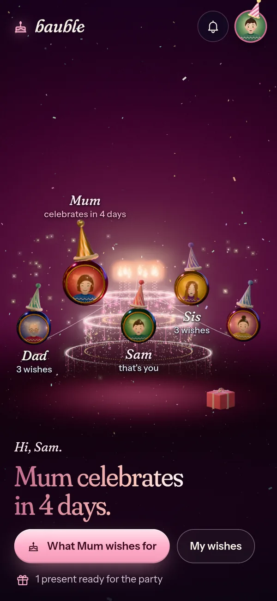
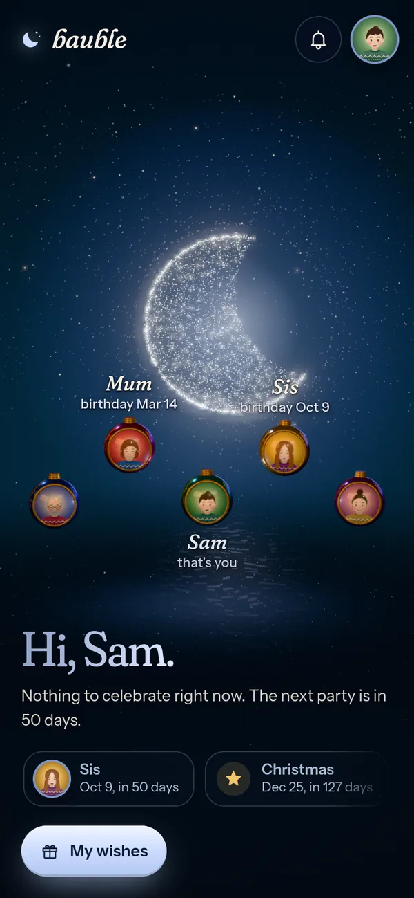
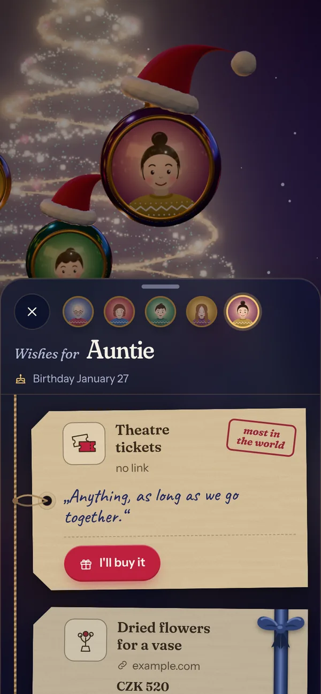
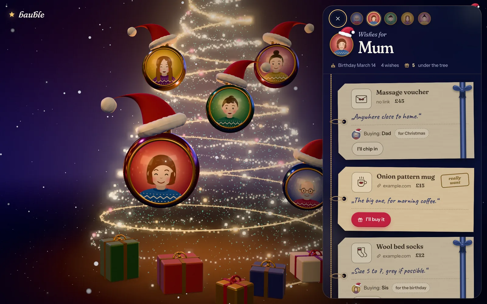

# bauble

<p align="center">
  
</p>

A family wish list that dresses up for whatever is coming next. Every family member is a glass
ornament with their photo. Before Christmas the ornaments hang on a tree made of light, before a
birthday they float over a cake as balloons, and in between they drift under the moon. Each wish
is a gift tag. Anyone can say "I'll buy it", and the person who made the wish never finds out who
is buying what until the morning after the occasion.

Czech and English. One PocketBase binary serves everything: the site, the API, realtime updates
and the admin dashboard.

<p align="center">
  
  &nbsp;
  
  &nbsp;
  
</p>
<p align="center"><sub>Before a birthday, the quiet months, and someone's list, on a phone. Every screen is also in Czech.</sub></p>

```
web/             Svelte + TypeScript client (Vite), three.js scene
pb_hooks/        server logic: claims, invites, link previews, request guard, `invite` command
pb_migrations/   schema and access rules
nix/             package, NixOS module, API test check
tests/           API tests (Python, standard library only)
docs/            README screenshots (scripts/screenshots.py)
```

## Deploy on NixOS

```nix
# flake.nix
inputs.bauble.url = "github:JirkaKlimes/bauble";

# configuration.nix
{ inputs, ... }: {
  imports = [ inputs.bauble.nixosModules.default ];

  services.bauble = {
    enable = true;
    url = "https://bauble.example.com";
    # PocketBase 0.39 or newer. On a stable channel, take it from unstable:
    # pocketbase = pkgs-unstable.pocketbase;
  };

  # public access through a Cloudflare tunnel, no open ports
  services.cloudflared = {
    enable = true;
    tunnels."<tunnel-uuid>" = {
      credentialsFile = "/run/secrets/cloudflared-bauble.json";
      default = "http_status:404";
      ingress."bauble.example.com" = "http://127.0.0.1:8090";
    };
  };
}
```

Create the tunnel once with `cloudflared tunnel create bauble` and point DNS at it with
`cloudflared tunnel route dns bauble bauble.example.com`.

### First run

The module installs `bauble-ctl`. It runs PocketBase commands as the service user against the
live database.

```sh
sudo bauble-ctl invite admin Alex   # prints https://bauble.example.com/i/<token>
```

Open the link and sign up. That first account is an admin. Admins create one-time invite links
for everyone else from their own list (valid 30 days, single use). Nobody can sign up without one.

### Admin dashboard

The PocketBase dashboard (`/_/`) only answers direct connections. Requests that come through
cloudflared or a reverse proxy get a 404. Use an SSH tunnel:

```sh
sudo bauble-ctl superuser upsert you@example.com 'a-long-password'
ssh -L 8090:127.0.0.1:8090 your-server   # then open http://127.0.0.1:8090/_/
```

Use it to reset a forgotten password, remove a member or change a role.

### Backups

All state is in `services.bauble.dataDir` (default `/var/lib/bauble`): SQLite and uploaded photos.
Snapshot it, or turn on scheduled backups in the dashboard.

## Deploy with Docker

```sh
docker compose up -d --build
docker compose run --rm bauble invite admin Alex
```

Set `BAUBLE_URL` in `docker-compose.yml` first. Read the security notes below: the container has
no egress filter.

## How it behaves

<p align="center">
  
</p>

**Occasions.** The Christmas season runs from 15 October to 26 December, and gifts are for
Christmas Eve. A birthday takes over 21 days before, on the day and the day after. Inside the
Christmas season it takes over only 7 days before. Of two birthdays close together, the nearer
wins. Otherwise the quiet scene shows what comes next.

**Claims.** "I'll buy it" ties the claim to the recipient's next occasion. The buyer can move it to
the other one (Christmas or birthday). Others can join a claim. The server hides claims on your own
wishes from you until local midnight after the occasion. Then the list offers to unwrap them and
shows who gave what. Bought wishes leave everyone's list after the occasion.

**Removing a wish someone is buying.** The owner sees it disappear like any other delete. The
buyers keep it, crossed out, with a note, and can let it go. "I already have it" works the same way.
To make sure the owner cannot tell the difference, every delete is a soft delete on the server,
the owner can never read or change a removed wish again, and a job purges the unclaimed ones every
ten minutes. Undo happens in the browser: the request goes out when the undo toast closes.

**Link previews.** Pasting a shop link makes the server read the page title, price and image
(Open Graph, JSON-LD). Shops with bot protection fail. Then the title comes from the URL and can be
edited. Product images are downloaded once and served from PocketBase.

**Admins** also get the time machine to preview any date. Nothing can be changed while previewing.

## Security notes

- Claim secrecy is enforced by access rules, not by the client. Client queries may not join
  through back-relations (`*_via_*`, `@collection`), because a sort over a hidden relation still
  changes which rows come back.
- Link previews fetch URLs that members paste. The hooks reject private and local addresses, but
  PocketBase follows redirects and resolves DNS on its own, so the NixOS module also blocks private
  ranges (RFC 1918, CGNAT/tailnet, link-local) at the socket with `IPAddressDeny`. Loopback stays
  open for the tunnel. With Docker, add your own egress filter, or accept that family members can
  make the server send GET requests into your network.
- `previewBlocklist` (`BAUBLE_PREVIEW_BLOCK`) blocks public names of internal services.
- Rate limits are on. PocketBase trusts the `CF-Connecting-IP` header for client IPs. Without
  Cloudflare in front, clear it in the dashboard (Settings, Trusted proxy).
- Responses carry a strict Content-Security-Policy.

## Develop

```sh
nix develop
npm --prefix web ci
npm --prefix web run build
./scripts/dev.sh serve               # http://127.0.0.1:8090
./scripts/dev.sh invite admin Alex   # first sign-up link
npm --prefix web run dev             # Vite with hot reload on :5173
open 'http://127.0.0.1:8090/?demo'   # in-memory demo family, no account needed
./tests/run_api_tests.sh             # API tests against a throwaway database
python3 web/e2e/e2e.py http://127.0.0.1:8090 <invite-link>   # browser run, needs web/dist
nix flake check                      # API tests and a NixOS VM test
python3 scripts/screenshots.py       # retake docs/*.webp from the demo, renders on the GPU
```

## Known limits

- Password reset is manual (dashboard). There is no SMTP setup and no "forgot password" screen.
- Up to 12 people get their own spot on the tree. More than that will overlap.
- Czech name forms (vocative, genitive, instrumental) are guessed by rule. The greeting form can be
  edited at sign-up and in the profile.
- The 3D scene needs WebGL. Without it the page shows names and lists only.
